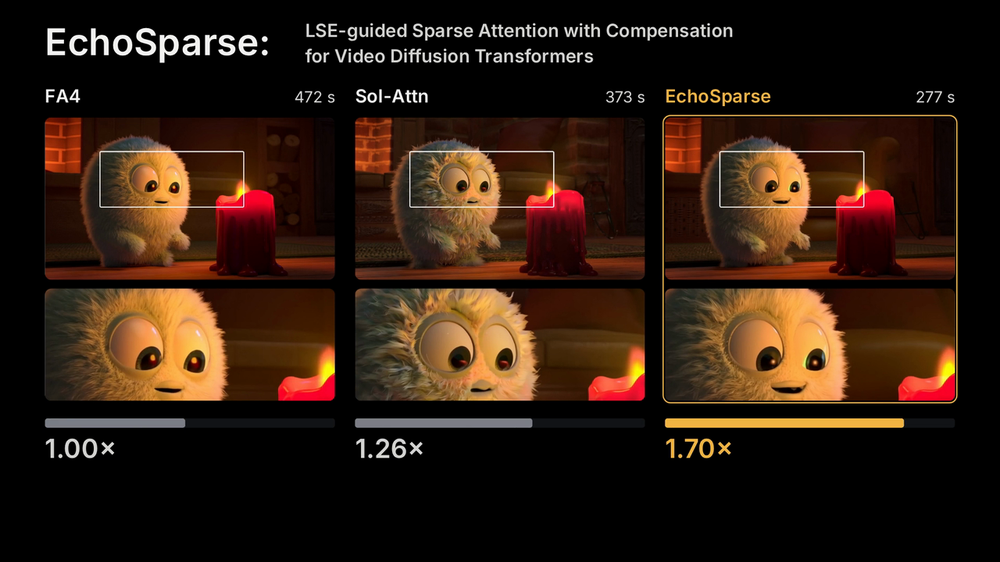
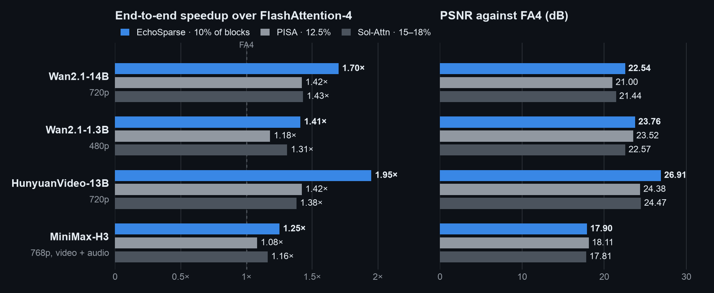

# EchoSparse：复用上一去噪步的统计量，用多级近似代替丢弃，并打包稀疏 attention 的计算

作者 **EchoSparse Team**

视频扩散模型的 self-attention 序列很长。以 Wan2.1-14B 生成 720p、81 帧视频为例，每层 attention 要处理约 7.56 万个 token。对一个 query 来说，很多 KV 块的贡献都很小。

LLM 上已有不少高稀疏度的做法，例如滑动窗口 attention（SWA），以及 GDN、KDA 这类线性 attention。这些做法基本都在训练时就写进了模型结构。本文讨论另一种情况：视频 DiT 已经用稠密 softmax attention 训练完成，我们不重新训练，直接替换它的 attention。视频里一个 query 的概率质量往往分散在时空方向的很多块上。每个块的质量都小，加起来的占比却不可忽略。直接丢掉这些块，softmax 的分子和分母都会改变，整行的加权方式也随之改变。不重新训练时，这种改变通常会在生成的画面上表现出来。在训练阶段就引入 SWA 或线性 attention 的视频模型属于另一类方法，本文不涉及。

我们的工作以两项已有方法为基础：Haopeng Li 等人的 PISA（[论文](https://arxiv.org/abs/2602.01077)，[代码](https://github.com/xie-lab-ml/piecewise-sparse-attention)），以及 Sol-Attn（[项目页](https://nvlabs.github.io/Sana/Sol-Attn/)，[论文](https://arxiv.org/abs/2607.24027)）。两者对未选中的块都做近似计算。PISA 把每个块的处理从“保留或丢弃”改为“精确计算或近似”：重要的块精确计算，其余块用块内 Taylor 展开近似。Sol-Attn 给未选中的块加零阶补偿，并用一张 query token 对池化 key 块的 score tile 选择块。两种方法的补偿项都计入 attention 的分子和分母，多个块的代表向量也都已经拼在一起做 GEMM。

EchoSparse 在此基础上做了三项改动：

1. **复用上一步的统计量。** 相邻两个去噪步之间，每个 attention 行的统计量变化很小。因此上一步的 LSE（log-sum-exp，即 softmax 分母的对数）和每个块的质量（block mass，即一个块分到的 attention 概率之和）可以直接用在本步。FlashAttention 的内循环在每个 KV tile 上都要做三项计算：行最大值归约、缩放系数计算和旧累积量的重缩放。把 LSE 用作 softmax 的固定偏移后，这三项都可以去掉。块质量则给出块之间的相对重要性。
2. **多层级代表块。** 一个块用多少个代表参与计算（记为 $m_b$）可以在 1、2、4、8 直到 64 之间选择，64 就是原始 token。代表越多，近似越精细，开销也越大。目前的实现只用了 1、4、64 三档。
3. **代表块的打包（packing）。** 代表项的计算很零碎，例如 $(B_q\times d)(d\times1)$、$(B_q\times d)(d\times1)$、$(B_q\times d)(d\times4)$。它们可以合成一次 $(B_q\times d)(d\times[1+1+4])$ 的计算。拼接、搬运和同步本身也有开销，所以数据要组织成足够宽的 tile，并让搬运和计算同时进行。

代码：**[W2GenAI-Lab/EchoSparse-Attn](https://github.com/W2GenAI-Lab/EchoSparse-Attn)**。

[](assets/echosparse-v13-1080p.mp4)

## 1. 处理一个 KV 块的几种方式（基线方法 PISA）

记全序列长度为 $N$，key 维度为 $d$，value 维度为 $d_v$。query 按 $B_q$ 行切成 tile，KV 按 $B_k$ 个 token 切成块，块 $b$ 用 $m_b$ 个代表行参与计算。本文实现中 $B_q=128$、$B_k=64$、$d=d_v=128$。对一个 query tile $Q\in\mathbb R^{B_q\times d}$ 和一个块 $K_b\in\mathbb R^{B_k\times d}$、$V_b\in\mathbb R^{B_k\times d_v}$，精确计算为

$$
S_b=\frac{QK_b^\top}{\sqrt d}\in\mathbb R^{B_q\times B_k},\qquad
P_b=\exp\bigl(S_b-c\,\mathbf 1^\top\bigr),\qquad
\mathcal N\mathrel{+}=P_bV_b,\qquad
\mathcal D\mathrel{+}=P_b\mathbf 1 .
$$

其中 $c\in\mathbb R^{B_q}$ 是每行的偏移，$\mathcal N\in\mathbb R^{B_q\times d_v}$ 是未归一化的分子，$\mathcal D\in\mathbb R^{B_q}$ 是分母。所有块累加完后，$O=\mathrm{diag}(\mathcal D)^{-1}\mathcal N$。

下文用 $(B_q\times d)(d\times B_k)(B_k\times d_v)$ 简写计算的尺寸。两次矩阵乘之间还有逐元素的指数和整行共享的归一化，所以它和普通的三矩阵连乘不同。用这个简写比较三种处理方式：

- **精确计算（exact）**：$(B_q\times d)(d\times B_k)$ 得到 $B_qB_k$ 个 logit，做 $B_qB_k$ 次指数，再乘 $(B_q\times B_k)(B_k\times d_v)$。需要读 $B_k(d+d_v)$ 个元素，计算量约 $2B_qB_k(d+d_v)$ FLOPs。
- **丢弃（drop）**：SWA 和块稀疏方法中落选的块属于这一类，相当于 $B_k\to0$。这个块对 $\mathcal N$ 和 $\mathcal D$ 都没有贡献，分母因此偏小。
- **一个代表**：$(B_q\times d)(d\times1)$ 和 $(B_q\times1)(1\times d_v)$。需要读 $d+d_v$ 个元素，计算量约 $2B_q(d+d_v)$ FLOPs，为精确计算的 $1/B_k$。

### 零阶近似与 token 数

取一行 query $q$，设块里有 $n_b$ 个有效 token（通常 $n_b=B_k$，最后一个块可能更少）。令

$$
\bar k=\frac1{n_b}\sum_{j}k_j,\qquad \bar v=\frac1{n_b}\sum_j v_j,\qquad
\bar s=\frac{q^\top\bar k}{\sqrt d},\qquad
\delta_j=\frac{q^\top(k_j-\bar k)}{\sqrt d}.
$$

则 $s_j=\bar s+\delta_j$，且 $\sum_j\delta_j=0$。块的精确贡献为

$$
\sum_j e^{s_j}=e^{\bar s}\sum_j e^{\delta_j},\qquad
\sum_j e^{s_j}v_j=e^{\bar s}\sum_j e^{\delta_j}v_j .
$$

零阶近似取 $e^{\delta_j}\approx1$：

$$
\mathcal D_b^{(0)}=n_b\,e^{\bar s}=e^{\bar s+\ln n_b},\qquad
\mathcal N_b^{(0)}=e^{\bar s}\sum_j v_j=n_b\,e^{\bar s}\,\bar v .
$$

因此一个代表由三项组成：$(\bar k,\bar v,n_b)$。它在分子和分母里都按 $n_b$ 个 token 计。代表和精确 token 一起计算时，可以把 token 数并入 logit，代表的 logit 记为 $\bar s+\ln n_b$。实现中使用 $\exp_2$，所以加的是 $\log_2 n_b$，满块时为 $\log_2 64=6$。漏掉这一项时，整块的权重会小 64 倍，相当于 logit 少了 $\ln 64\approx4.16$。

### 一阶与二阶近似

继续展开 $e^{\delta}=1+\delta+\tfrac12\delta^2+\cdots$。到一阶时，分母新增的项 $\sum_j\delta_j=0$，分子新增的项不为零：

$$
\sum_j\delta_j v_j=\frac{H^\top q}{\sqrt d},\qquad
H=\sum_j (k_j-\bar k)\,v_j^\top\in\mathbb R^{d\times d_v},
$$

$$
\mathcal N_b^{(1)}=e^{\bar s}\Bigl(\sum_j v_j+\frac{H^\top q}{\sqrt d}\Bigr),\qquad \mathcal D_b^{(1)}=n_b\,e^{\bar s}.
$$

$H$ 描述块内 key 偏移与 value 的相关性，均值代表不包含这部分信息。二阶还需要

$$
C=\sum_j (k_j-\bar k)(k_j-\bar k)^\top\in\mathbb R^{d\times d},\qquad
T=\sum_j (k_j-\bar k)\otimes(k_j-\bar k)\otimes v_j\in\mathbb R^{d\times d\times d_v},
$$

$$
\mathcal D_b^{(2)}=e^{\bar s}\Bigl(n_b+\frac{q^\top Cq}{2d}\Bigr),\qquad
\mathcal N_b^{(2)}=\mathcal N_b^{(1)}+\frac{e^{\bar s}}{2d}\,T(q,q,\cdot).
$$

如果为每个块显式缓存这些矩（$B_k=64$、$d=d_v=128$），代价如下：

| 每块保存的量 | 元素数 | 数值 | 每个 query 的计算量 |
|---|---|---:|---|
| 原始 $K_b,V_b$（精确计算） | $B_k(d+d_v)$ | 16,384 | $O(B_k(d+d_v))$ |
| 零阶 $\bar k,\bar v,n_b$ | $d+d_v+1$ | 257 | $O(d+d_v)$ |
| 一阶 $H$ | $dd_v$ | 16,384 | $O(dd_v)$ |
| 二阶 $C,T$ | $d^2+d^2d_v$ | 2,113,536 | $O(d^2d_v)$ |

在这个形状下，$dd_v=128\times128=B_k(d+d_v)=64\times256$。因此逐块的一阶矩和原始块一样大，把它作用到一个 query tile 上（$(B_q\times d)(d\times d_v)$）的 FLOPs 也和精确计算这个块相当。二阶的 $T$ 不压缩时有 $d^2d_v=2{,}097{,}152$ 个元素，是原始块的 128 倍。利用两个 key 下标的对称性可以降到 $d(d+1)d_v/2\approx106$ 万，仍约为原始块的 64.5 倍。以上是直接缓存的代价。如果改为不缓存、回读 token，或者使用低秩、结构化的近似，就需要额外的计算，或者引入新的近似假设。

PISA 实际采用的是**逐块零阶加全局一阶**。记 $\mathcal U$ 为某个 query tile 的落选块集合。下面只考虑满块，不考虑尾块。理想的逐块一阶项 $\sum_{b\in\mathcal U} e^{\bar s_b}H_b^\top q/\sqrt d$ 在 PISA 中被替换为 $\bigl(\sum_{b\in\mathcal U} e^{\bar s_b}\bigr)\bar H^\top q/\sqrt d$。求和只遍历 $\mathcal U$。$\bar H$ 是在整个序列上预先汇总的全局一阶统计量，不随每个 query tile 的 $\mathcal U$ 重新计算。满块等长时，$\bar H$ 可以看作各块 $H_b$ 的平均；生产代码对尾块另外按 token 数缩放。预处理阶段先算出每块的 $H_b$ 再做归约，attention 内循环只加载这一个全局矩阵。这一替换本身也引入了近似。关于二阶，PISA 在相关工作部分结合 Based 和 power attention 讨论过 Taylor 特征维度的膨胀。上表的代价按直接缓存的方式计算，PISA 的 kernel 并不存储逐块二阶张量。

EchoSparse 保持零阶近似，把一个块分成更多组，组数 $m_b$ 可变（见第 3 节）。

## 2. 复用上一步的 LSE

FlashAttention 类 kernel 按 KV tile 依次扫描，用 online softmax 维护每行的运行最大值。实现中统一使用 $\exp_2$，本节的 $s_{ij}$ 都已乘过 $\log_2 e$。对每个 KV tile，每一行 $i$ 要计算：

$$
\begin{aligned}
m_i^{\text{new}}&=\max\bigl(m_i,\ \max_j s_{ij}\bigr),\qquad
\alpha_i=2^{\,m_i-m_i^{\text{new}}},\qquad
p_{ij}=2^{\,s_{ij}-m_i^{\text{new}}},\\
\ell_i&\leftarrow\alpha_i\,\ell_i+\sum_j p_{ij},\qquad
O_i\leftarrow\alpha_i\,O_i+\sum_j p_{ij}v_j .
\end{aligned}
$$

如果每行事先给定一个固定偏移 $\hat a_i$，循环简化为

$$
p_{ij}=2^{\,s_{ij}-\hat a_i},\qquad \ell_i\leftarrow\ell_i+\sum_jp_{ij},\qquad O_i\leftarrow O_i+\sum_jp_{ij}v_j .
$$

EchoSparse 取 $\hat a_i$ 为上一去噪步中同一层、同一 CFG 分支、同一行的 log2 LSE。下面对比[固定偏移路径](https://github.com/W2GenAI-Lab/EchoSparse-Attn/blob/fe8c7452916c74fe9243d65be070b4d9c378e080/echosparse/kernels/sm120.py#L35-L59)和 [online 回退路径](https://github.com/W2GenAI-Lab/EchoSparse-Attn/blob/fe8c7452916c74fe9243d65be070b4d9c378e080/echosparse/kernels/sm120.py#L146-L166)。

参数取 `BM=128`、`BN=64`、`D=Dv=128`，`scale2=log2(e)/sqrt(D)`。原始 token 的 `log_count` 为 0，代表项为 $\log_2 n$。SM120 主线把 64-token 块分成两个 32-key 半块，H100 实验路径使用 64 宽的 tile。

```python
# Online softmax
m = tl.full((BM,), -float("inf"), tl.float32)
l = tl.zeros((BM,), tl.float32)
acc = tl.zeros((BM, Dv), tl.float32)
for k, v, log_count in kv_tiles:
    s2 = tl.dot(q, tl.trans(k)) * scale2 + log_count[None, :]
    block_max = tl.max(s2, axis=1)
    m_new = tl.maximum(m, block_max)
    alpha = tl.exp2(m - m_new)
    p = tl.exp2(s2 - m_new[:, None])
    l = l * alpha + tl.sum(p, axis=1)
    acc = acc * alpha[:, None]
    acc = tl.dot(p.to(tl.bfloat16), v, acc)
    m = m_new
out = acc / l[:, None]
new_lse2 = m + tl.log2(l)

# Fixed offset
prior2 = tl.load(PREV_LSE2 + rows * H + head)
l = tl.zeros((BM,), tl.float32)
acc = tl.zeros((BM, Dv), tl.float32)
for k, v, log_count in kv_tiles:
    s2 = tl.dot(q, tl.trans(k)) * scale2 + log_count[None, :]
    p = tl.exp2(s2 - prior2[:, None])
    l += tl.sum(p, axis=1)
    acc = tl.dot(p.to(tl.bfloat16), v, acc)
out = acc / l[:, None]
new_lse2 = prior2 + tl.log2(l)
```

每个 KV tile 省掉的计算有：

- **行最大值归约**：对 128 行、每行 64 个元素求最大值。逻辑上约 $128\times63$ 次比较，加上 lane 间的归约，另有 128 次运行最大值的比较。
- **缩放系数**：128 个 $\alpha_i=2^{m_i-m_i^{\text{new}}}$。$128\times64=8192$ 个 $p_{ij}$ 的 $\exp_2$ 仍然要算。
- **旧累积量的重缩放**：分母 128 个元素，输出累积器 $128\times128=16{,}384$ 个 FP32 元素。

这里统计的是逻辑运算量，和机器指令数并不一一对应。累积器位于片上，这些运算也不产生显存流量。它们在每个 KV tile 上都会重复：密度为 0.10 时，每个 query tile 平均约有 118 个精确块，仅精确块循环就有约 190 万次累积器乘法。固定偏移新增的开销只有一项：循环开始前每行读一个 FP32 的上一步 LSE，每个 tile 共 512 字节。QK、逐个 score 的 $\exp_2$、行求和、PV、用本步分母做的最终归一化、新 LSE 的 $\log_2\ell$，以及循环结束后的范围检查都保留。

固定偏移还缩短了依赖链：

```text
online:  S ──> row max ──> m_new ──> exp2(S - m_new) ──> P·V ──┐
                             └──> alpha ──> scale old O ───────┴──> O
fixed:   S ──────────────────────> exp2(S - prior) ──> P·V ──────> O
```

在 online 版本中，$p_{ij}$ 要等本 tile 的行最大值归约完成才能计算；新的 PV 累加进 $O$ 之前，旧的 $O$ 要先乘以 $\alpha$。QK 和 PV 在 Tensor Core 上执行，求最大值、归约和逐行缩放在普通执行单元和 SFU 上执行。后面这几步夹在两次矩阵乘之间，会拉长关键路径。使用固定偏移后，依赖链只剩 $S\to\exp_2\to PV$，更容易与数据搬运和下一轮 QK 重叠。

在 B200 上，目前固定偏移的 CuTe DSL 实现把 $O$ 放在 TMEM（Blackwell 的张量内存）中。所有 PV 的 MMA 都直接累加到同一块 `tO`，只在第一次清零。循环中，kernel 从 TMEM 读出 score，减去固定的 LSE，做 $\exp_2$，转成 BF16 写回，再累加分母。循环结束后，kernel 才把 $O$ 读到寄存器，除以本步的行和，写出输出和新的 LSE（[源码](https://github.com/W2GenAI-Lab/EchoSparse-Attn/blob/fe8c7452916c74fe9243d65be070b4d9c378e080/echosparse/kernels/sparse_attention.py#L354-L393)）。整个过程没有逐轮的 $O$ 行缩放。

### 固定偏移不改变计算结果

对同一组项，分子和分母都乘以同一个 $2^{-\hat a_i}$，比值不变：

$$
\frac{O_i}{\ell_i}=\frac{\sum_j 2^{s_{ij}-\hat a_i}v_j}{\sum_j 2^{s_{ij}-\hat a_i}}=\frac{\sum_j 2^{s_{ij}}v_j}{\sum_j 2^{s_{ij}}},\qquad
\hat a_i+\log_2\ell_i=\log_2\sum_j2^{s_{ij}} .
$$

最后的除数是本步累加出的 $\ell_i$。因此在数学上，$\hat a_i$ 取任何值结果都相同，只有浮点求和与舍入会带来细微差别。前后两步的 LSE 是否接近，影响的是数值范围。记本步的 log2 LSE 为 $\mathrm{lse}^{(2)}_i$，则 $\ell_i=2^{\,\mathrm{lse}^{(2)}_i-\hat a_i}$。偏移越准，$\ell_i$ 越接近 1，$p_{ij}$ 越不容易上溢或下溢。


*图 1　相邻去噪步之间同一行 LSE 的变化（Wan2.1-1.3B，稠密 FA4，5 个提示词，自然对数单位，B200 上的早期实验）。图中的点是报告给出的 7 个汇总值。数据：[REPORT.md §3](https://github.com/Owen718/lse-sparse/blob/05e2dab310bf7c710d8b5276aa588e433823db15/docs/REPORT.md#3-相邻去噪步的-lse-变化13b5-个提示词)。*

去噪中段，变化的中位数只有 0.05 到 0.1。第 1 步的中位数是 0.76，第 49 步是 0.28，对应的 p99 分别是 2.88 和 1.11。个别（层，头）组合上的变化达到 100 以上。因此 kernel 在循环结束后检查 $\log_2\ell_i$，超出约 $\pm60$ 的 tile 会被标记，README 给出的比例约为 0.5%。被标记的 tile 走回退路径：它选中的精确块用 online softmax 重算，其余块统一用单个均值补偿，回退路径不使用四代表。在相同块列表下，仓库测得 kernel 时间减少约 47%。

## 3. 多层级代表块

### 3.1 多层级表示

把块 $b$ 的 token 分成 $m_b$ 组，每组用自己的 K/V 均值和真实 token 数做零阶近似。原始 token 和代表都写成三元组 $(\tilde k_a,\tilde v_a,n_a)$，进入同一个分子和分母：

$$
\tilde o=\frac{\sum_a n_a\,e^{\,q^\top\tilde k_a/\sqrt d}\,\tilde v_a}{\sum_a n_a\,e^{\,q^\top\tilde k_a/\sqrt d}} .
$$

- $m_b=1$：整块一个均值，$n=n_b$；
- $m_b=4$：四个聚类，每个聚类有自己的 K/V 均值和 token 数；
- $m_b=64$：每个 token 一组，$n=1$，等同于精确计算。

2、8、16、32 也是可选的档位，目前代码只实现了 1、4、64。构造四代表的 kernel 把聚类数补到 16 行，以满足 `tl.dot` 的最小尺寸要求。

$n_a$ 必须同时出现在分子和分母里。空聚类和补齐行的 $\ln n_a=-\infty$，权重为零。精确项和压缩项共用一个分子和一个分母。如果两部分分别做 softmax 再相加，每部分都会被归一化成 1，块之间的相对质量就丢失了。

$m_b$ 增大时，分组变细，每组仍然是零阶近似。组与组之间的 logit 差异由各组自己的指数精确表示，被近似掉的只有组内偏移。举一个 4-token 块的例子：logits $s=(0,0,2,2)$，$v=(1,1,0,0)$，精确输出为 $2/(2+2e^2)\approx0.119$。用一个均值时，平均 logit 为 1，$n=4$，输出等于平均的 $v$，即 0.5。分成 $(0,0)$ 和 $(2,2)$ 两组、每组 $n=2$ 时，组内 logit 相同，结果和精确值一致。一般来说，对固定的 query，只要一组内所有 key 的 logit 相同，按 token 数加权的代表就能精确还原这一组。key 完全相同是这个条件的一个特例。每组只有一个 token 时，就回到了精确计算。

每块读取 $m_b(d+d_v)$ 个元素，GEMM 的计算量约 $2B_qm_b(d+d_v)$ FLOPs。最终的输出误差还取决于组内 logit 方差和 K/V 的相关性，代表数只是其中一个因素。

### 3.2 按块质量选择 $m_b=1$、$4$、$64$

对 query tile $a$ 和块 $b$，定义

$$
M_{ab}=\sum_{i\in a}\sum_{j\in b}e^{\,s_{ij}-c_i},\qquad c_i=(\ln2)\,\hat a_i ,
$$

这里使用自然对数单位：$s_{ij}=q_i^\top k_j/\sqrt d$ 是普通的 logit，$c_i$ 是把第 2 节的 log2 LSE $\hat a_i$ 换算成自然对数后的上一步 LSE。kernel 里的 $p_{ij}=2^{\,s^{(2)}_{ij}-\hat a_i}$（$s^{(2)}_{ij}=s_{ij}\log_2 e$）与 $e^{s_{ij}-c_i}$ 是同一个数。$M_{ab}$ 是用上一步 LSE 缩放的未归一化块质量。上一步的 LSE 接近本步的真实 LSE 时，$M_{ab}$ 接近 tile $a$ 各行在块 $b$ 上的概率之和。两者在每一行上相差一个由两步 LSE 之差决定的因子。

这张质量图由本步的 attention kernel 在计算过程中顺带得到，没有单独的打分步骤：

- **精确块**：$e^{s_{ij}-c_i}$ 本身就在概率的量级。kernel 计算选中的块时，按 64-token 块累加 $p_{ij}$，就得到这些块的 $M_{ab}$。
- **落选块**：没有精确的 $s_{ij}$。`estimate_skipped` 在每个 query tile 中抽取若干行，用块均值估计落选块的质量，再用同一 tile 中已精确计算的块校准。校准系数限制在 $[1,64]$ 之内。

两部分按 tile 汇总后，再乘以 $\exp(c_i-\mathrm{LSE}^{\text{new}}_i)$ 重新缩放，得到下一步使用的质量图。这里 $\mathrm{LSE}^{\text{new}}_i$ 是本步算出的自然对数 LSE，在 log2 实现中对应 `2^(prior2 - new_lse2)`。

下一步按质量排序分配：共有 $n_{\text{blk}}$ 个块、密度为 $\rho$ 时，质量最大的 $\mathrm{round}(\rho\,n_{\text{blk}})$ 个块和局部邻居做精确计算；落选块中质量最高的约三分之一用 4 个代表；其余块用 1 个均值。没有块被丢弃。这个分配规则按质量排序，属于启发式方法，没有从误差公式推导最优分配。


*图 2　LSE 作为固定偏移，块质量决定每个块用多少代表；kernel 输出下一步使用的 LSE 和块质量。*

每个（CFG 分支，层）各自保存状态，CFG 的其他分支可以复用分支 0 的块选择。默认设置下，前 9 步用 FA4 做稠密计算。第 10 步让所有块都经过固定偏移的 EchoSparse kernel，输出是精确的，同时建立第一张质量图。第 11 步起进入稀疏计算。


*图 3　B200 早期实验：Wan2.1-1.3B 每个去噪步两路 CFG forward 的耗时（三次运行的中位数和范围）。稀疏组使用早期的单均值版本，未包含当前的四代表和打包实现。数据：[curve13.json](https://github.com/Owen718/lse-sparse/blob/05e2dab310bf7c710d8b5276aa588e433823db15/outputs/results/curve13.json)。*

### 3.3 近似误差与聚类目标

考虑一组 $C$，含 $n$ 个 token，记号同第 1 节：组均值为 $\bar k,\bar v$，$\bar s=q^\top\bar k/\sqrt d$，$\delta_j=q^\top(k_j-\bar k)/\sqrt d$，$\mathbb E_C\delta=0$。精确分母和代表分母分别为

$$
Z_C=n\,e^{\bar s}\,\mathbb E_Ce^{\delta},\qquad \widehat Z_C=n\,e^{\bar s},\qquad
\mathbb E_Ce^{\delta}=1+\tfrac12\mathbb E_C\delta^2+O\bigl(\mathbb E_C|\delta|^3\bigr).
$$

由于使用普通均值，一阶项相互抵消，分母误差的主项是组内 logit 方差。若 $|\delta_j|\le r$，由 $e^\delta-1-\delta=\tfrac12\delta^2e^{\xi}$ 可得

$$
0\le Z_C-\widehat Z_C\le\frac{n\,e^{\bar s+r}}{2}\,\mathbb E_C\delta^2 .
$$

左边非负来自 Jensen 不等式：代表总是低估这一组的分母。分子误差还和 value 有关：

$$
\mathcal N_C-\widehat{\mathcal N}_C=n\,e^{\bar s}\Bigl[\mathrm{Cov}_C(\delta,v)+\tfrac12\,\mathbb E_C\bigl(\delta^2v\bigr)+\cdots\Bigr].
$$

第一项就是组内一阶矩 $H_C^\top q/(n\sqrt d)$。整块的一阶矩可以分成组内和组间两部分：

$$
H_b=\sum_C H_C+\sum_C n_C\,(\bar k_C-\bar k_b)(\bar v_C-\bar v_b)^\top .
$$

分成 $m_b$ 组后，组间部分由各组自己的中心和指数在所有阶上精确表示，只需要 $m_b(d+d_v)$ 的存储，不需要 $d\times d_v$ 的矩阵。剩下的误差来自组内的 $H_C$、组内方差和更高阶的项，每组只有一个 token 时全部为零。与第 1 节对比：为每块存一个 $dd_v$ 大小的一阶矩，存储量与原始块相同；把块分成几组，只需要几列。

分母误差的主项由组内 logit 方差决定，所以可以把平均平方 logit 偏差作为分组的目标。把当前 head 的所有 query 按行排成 $Q\in\mathbb R^{N\times d}$。对一个 $B_k$-token 的块 $b$，记它的分组为 $\mathcal C_b$，组内偏移为 $\Delta k_j=k_j-\bar k_C$，目标写成

$$
J_b=\frac1{NB_k}\sum_{i=1}^N\sum_{C\in\mathcal C_b}\sum_{j\in C}
\left(\frac{q_i^\top\Delta k_j}{\sqrt d}\right)^2 .
$$

直接按这个式子计算时，每次调整分组都要遍历所有 query。但 $q_i$ 与分组无关，可以先对 query 这一维求和：

$$
\begin{aligned}
G&=\frac1{Nd}\sum_{i=1}^N q_iq_i^\top=\frac{Q^\top Q}{Nd},\\
J_b&=\frac1{B_k}\sum_{C\in\mathcal C_b}\sum_{j\in C}\Delta k_j^\top G\,\Delta k_j .
\end{aligned}
$$

这样，所有 query 的作用都汇总到一个 $d\times d$ 矩阵 $G$ 中。$Q^\top Q$ 是一次 Gram 矩阵乘，可以在 Tensor Core 上完成：输入是 $N\times d$，输出只有 $d\times d$，$d=128$ 时就是 $128\times128$。它的计算量为 $O(Nd^2)$，完整的 $QK^\top$ 则是 $O(N^2d)$。每次 attention 调用中，每个 head 只算一份 $G$。该 head 的所有 KV 块和后续的聚类迭代都复用它，不需要为每个 query tile 重算。

接下来要高效计算 $\Delta k^\top G\Delta k$。直接计算这个二次型时，每个点与一个候选中心的距离比较需要 $O(d^2)$ 的计算。Cholesky 分解把对称正定矩阵写成一个下三角矩阵与其转置的乘积。$G$ 可能有 query 没有覆盖到的零方向，所以先加一个小的对角正则项，让分解更稳定：

$$
G_\epsilon=G+\epsilon I=MM^\top,\qquad
\epsilon=10^{-3}\frac{\operatorname{tr}(G)}d .
$$

二次型于是变成普通的平方长度：

$$
\begin{aligned}
\Delta k^\top G_\epsilon\Delta k
&=\Delta k^\top MM^\top\Delta k=\|M^\top\Delta k\|^2,\\
&=\Delta k^\top G\Delta k+\epsilon\|\Delta k\|^2 .
\end{aligned}
$$

所以只要预先把 key 变换为 $x_j=M^\top k_j$，后面就可以直接计算欧氏距离。代码中 key 按行存储，矩阵形式为 $X=KM$。线性变换保持均值，即 $\bar x_C=M^\top\bar k_C$，正则化后的目标变为

$$
\begin{aligned}
J_{b,\epsilon}
&=J_b+\frac\epsilon{B_k}\sum_{C\in\mathcal C_b}\sum_{j\in C}\|\Delta k_j\|^2,\\
&=\frac1{B_k}\sum_{C\in\mathcal C_b}\sum_{j\in C}\|x_j-\bar x_C\|^2 .
\end{aligned}
$$

这正是变换后坐标中的 k-means 平方距离目标。Cholesky 分解的计算量为 $O(d^3)$，但只对这个 $d\times d$ 的小矩阵做一次，得到的 $M$ 由所有块共享；$KM$ 也只在聚类前计算一次。之后每轮迭代只比较一个块的 64 个点和 4 个中心，复杂度为 $O(B_km_bd)$，与 query 数 $N$ 无关。总结起来，误差分析给出的分组目标分三步求解：计算一次 query 的 Gram 矩阵，对 key 做一次线性变换，再在每个块内做小规模的 k-means。

实现中还用 64 个探测 query（probe query）给 token 加权，使经常获得较高 attention 权重的 token 在分组中占更大比重。初始分组是四个连续的 16-token 组，之后最多做 6 次加权 Lloyd 迭代，中心按权重更新。分组确定后，写回的 K、V 仍是组内的普通均值，$n_a$ 是真实的 token 数。加权分组沿用上面的度量，在方差目标上加入了启发式的权重。最终 attention 输出的误差还受 K/V 相关性和统一归一化的影响。

## 4. 打包：把 1+1+4 拼成 6 列

实验形状 $N=75600$ 共有 $n_{\text{blk}}=1182$ 个 64-token 块（补齐后容量为 75648）。密度为 0.10 时，精确块约 118 个，合 $118\times64\approx7.6$ 千列。其余约 1064 个块中，约三分之一用四代表，约 355 块、1420 列；剩下约 709 块，每块 1 列。压缩列合计 $1420+709=2129$，与实验记录的平均值一致。每个 tile 约 9.7 千列，不到稠密计算的 13%。其中压缩列约占五分之一，但分布最零碎：有的块 1 列，有的块 4 列。

逐块计算时，这些是一串 $(B_q\times d)(d\times1)$、$(B_q\times d)(d\times4)$ 的小矩阵乘，列数远小于一次 Tensor Core MMA 的宽度。下面用最小的例子说明如何合成 $(B_q\times d)(d\times[1+1+4])$：块 1、块 2 各有一个均值代表，块 3 有四个代表，拼成

$$
K_*=\begin{bmatrix}\bar k_1^\top\\ \bar k_2^\top\\ K_3^{(4)}\end{bmatrix}\in\mathbb R^{6\times d},\qquad
V_*=\begin{bmatrix}\bar v_1^\top\\ \bar v_2^\top\\ V_3^{(4)}\end{bmatrix}\in\mathbb R^{6\times d_v},\qquad
n_*=(n_1,\,n_2,\,n_{3,1},\,\dots,\,n_{3,4}) .
$$

然后

$$
S=\frac{QK_*^\top}{\sqrt d}\in\mathbb R^{B_q\times6},\qquad
W=\exp\bigl(S-c\,\mathbf 1^\top+\mathbf 1\,(\ln n_*)^\top\bigr),
$$

$$
\mathcal N\mathrel{+}=WV_*,\qquad \mathcal D\mathrel{+}=W\mathbf 1,\qquad O=\mathrm{diag}(\mathcal D)^{-1}\mathcal N .
$$

$c$ 是第 1 节中的每行偏移，在 EchoSparse 中是自然对数单位的上一步 LSE，$c_i=(\ln2)\,\hat a_i$；下面的等价关系对任何固定偏移都成立。$QK_*^\top$ 的 6 列就是三个小矩阵乘各自的列；指数和 token 数修正都是逐元素的。把 $W$ 按列写成 $[W_1\ W_2\ W_3]$，有

$$
WV_*=W_1\bar v_1^\top+W_2\bar v_2^\top+W_3V_3^{(4)},\qquad W\mathbf 1=W_1\mathbf 1+W_2\mathbf 1+W_3\mathbf 1 ,
$$

即三个块对分子和分母的贡献都加进了同一个 $\mathcal N$、$\mathcal D$。$n_*$ 必须随列一起进入分子和分母。精确 token 也累加进同一对 $\mathcal N$、$\mathcal D$，全部扫描完后只做一次除法。如果三个块各自做 softmax 再把输出相加，每块都会被归一化成 1，结果就不同了。

因此，在相同的稀疏计划、代表 K/V、token 数和统一归一化下，打包只改变计算的分组方式，数学上输出相同。EchoSparse 相对稠密计算的全部近似都来自上一节的代表压缩。浮点求和顺序的改变会带来细微的舍入差别。

6 列远不够填满一个 Tensor Core tile，实际需要跨很多块拼接。实验分支每次迭代处理 128 列：均值流一次拼接 128 个块的均值，四代表流一次拼接 32 个块、每块 4 列。每条流只有最后一次迭代需要掩码。

已发布版本没有做打包（图中标为 nonpacked），它有三个循环：第一个遍历精确块列表；第二个以 128 列为单位扫描全部块的均值，并用掩码屏蔽精确块和四代表块对应的列；第三个遍历四代表块列表，每块一个 id，展开成 4 列，列表补齐到固定宽度。在这次测试的计划中，每个 tile 要处理 1280 个均值列和 1536 个代表列，共 2816 列，平均只有 2129 列有用，约占 76%。被屏蔽的列可以不搬数据，但 MMA 按固定形状发射，这部分计算开销仍然存在。


*图 4　示意图：同一组项在未打包的三个循环（nonpacked）和分组打包的两条流（grouped）中的排布，列数不按比例。*

实验分支的分组打包（grouped packing）为每个（query tile，head）生成两条紧凑的索引流，代码中称为 descriptor。均值流中一个块 id 对应一列；四代表流中一个块 id 对应 4 列，在片上按 $4\cdot\text{block}+\text{sub}$ 展开地址。更早的逐列打包给每个代表列存一个索引，一个四代表块占 4 个 id，分组打包只存 1 个。未打包版本的四代表列表本来就是每块一个 id。两类来源分在两个循环里处理，混合 tile 也就不需要对两个源张量都做带掩码的加载。

打包只作用于索引。代表 K/V 没有复制成连续张量，每次迭代仍按索引从原位置读取（gather）。

## 5. 数据搬运与流水线

如果把每个 tile 用到的代表 K/V 复制成连续张量，就可以像精确块一样整块搬运。但复制本身要读一次、写一次，kernel 还要再读一次，而且每个（query tile，head）选中的块都不同。按每个 tile 平均 2129 列、每列 $d+d_v=256$ 个 BF16 估算，每个 tile 约 1.09 MB。591 个 query tile 乘以 40 个 head，逐 tile 复制一遍要写约 26 GB。作为对比，同一计划下 NCU 记录的主 kernel DRAM 读取总量约为 9.7 GB。

不复制时，小块搬运也有固定开销：descriptor 和地址计算、对齐、通知数据到达的 barrier，以及 shared memory 缓冲区。负载越零碎，这些开销越难分摊。因此需要先把有效列拼成足够宽的 tile，再让搬运和计算重叠。

设每次迭代的装载耗时为 $t_\ell$、计算耗时为 $t_c$，共 $n$ 次迭代。串行执行的总时间是 $n(t_\ell+t_c)$。假设每次迭代耗时恒定，且搬运与计算完全重叠，两级流水线的总时间约为

$$
t_\ell+(n-1)\,\max(t_\ell,t_c)+t_c+t_{\text{sync}},
$$

首尾两项分别是流水线的填充和排空。不计 $t_{\text{sync}}$ 时，$n=1$ 退化为串行的 $t_\ell+t_c$。$t_{\text{sync}}$ 表示没有被隐藏的等待和 barrier 开销。$n$ 较小时，填充和排空的占比较大。按前面的计数，每个 tile 的精确块循环约 118 次迭代，均值流约 6 次（709/128），四代表流约 12 次（355/32）。在 Wan2.1-14B 的形状下，按未打包基线实际执行的列数计，精确块循环约占 73%（$7552/(7552+2816)$；按分组打包的有用列计约占 78%）。所以流水线先加在精确块循环上。

H100 的 TMA（Tensor Memory Accelerator）用一个 descriptor 描述张量的形状，由专用硬件把整块数据异步搬进 shared memory。K、V 的布局是 `[N,H,D]`。一个 64-token 块是一个按原张量步长描述的矩形 tile（$H>1$ 时在 token 方向不连续），用 block shape 为 `[64,1,D]` 的 descriptor 在行偏移 $64\cdot\text{block}$ 处取出。


*图 5　精确块循环三级软件流水线的示意时间线（非实测）。TMA 只用于精确块。*

实验分支目前的做法是：精确块通过 TMA 加载，用三级软件流水线让搬运和 dot 重叠；代表列按分组打包的索引逐列读取。三级流水线由 Triton 的软件流水调度生成，三个 stage 是环形缓冲区的三个槽位。第 0 块计算完、槽位释放后，第 3 块才能装入同一个槽位；计算等待数据到达，装载等待槽位空出。只开 TMA、不加流水线时几乎没有收益（主 kernel 57.15 ms 对 57.22 ms），两者一起使用才有效。流水级数从 3 增加到 6，时间基本不变。

在同一 Wan2.1-14B 计划的 NCU 测量中，加入 TMA 后，指令数从 10.42 G 降到 9.79 G，主 kernel 耗时从 39.06 ms 降到 35.64 ms。barrier 和 wait 仍占约四成 warp 周期。搬运指令减少以后，同步仍是主要开销。

代表流可以改成生产者–消费者（producer–consumer）结构：生产者 warp 按分组打包的索引读取后续的代表列，在 shared memory 的三个槽位里整理成满宽的 tile；消费者 warp 对已就绪的槽位做 QK、$\exp_2$ 和 PV，累加进同一对 $\mathcal N$、$\mathcal D$，用完后释放槽位。消费者等待数据到达，生产者等待槽位空出。

## 6. 实验结果

### H100 单次 attention（实验分支）


<div class="results">

| 方案 | 耗时 | 相对稠密 FA4 | 相对已发布版 |
|---|---:|---:|---:|
| 稠密 FlashAttention-4 | 163.48 ms | 1.00× | — |
| EchoSparse 已发布版（未打包） | 71.65 ms | 2.28× | 1.00× |
| 分组打包 + TMA + 三级流水线（实验分支） | 44.51 ms | 3.67× | 1.61× |

</div>

输入为合成的 BF16 数据，形状 `[B,N,H,D]=[1,75600,40,128]`，非因果，密度 0.10，计时 20 次取中位数。稀疏方案的计时覆盖整个 GPU 流程，包括代表构造和打包。后两行使用同一份固定的稀疏计划，比较的只是实现方式，1.61× 来自打包和流水线。稠密一行计算全部原始 token，3.67× 中还包含稀疏本身带来的加速。这是单次 attention 的结果，整段视频生成的加速需要另外测量。原始记录：[evidence/h100_attention_benchmark.json](evidence/h100_attention_benchmark.json)。

### B200 与 RTX 5090 完整视频生成



*B200 发布结果：50 步完整视频生成，与 Sol-Attn、PISA 对比，PSNR 以稠密 FA4 的输出为参照。*


*RTX 5090 发布结果：单 GPU，每个模型用一个固定的提示词和 seed 做 50 步生成；右侧 PSNR 旁边列出同一提示词在 B200 上的数值。*

Wan2.1-14B 生成整段视频的加速比在 B200 上是 1.70×，在 RTX 5090 上是 1.39×（同一模型单个稀疏步的 forward 为 1.61×）。两组评测的设置不同：RTX 5090 上每个模型只跑了一个提示词；Wan2.1-14B、HunyuanVideo 和 MiniMax-H3 还把权重放在 CPU 内存里，分组搬到 GPU 上计算（CPU offload）。因此这两个数不能直接当作两种硬件的对比。

## 7. 总结

视频扩散模型中，低权重的 KV 块数量很多，加起来仍会明显影响 softmax 的分子和分母。EchoSparse 用按 token 数加权的代表近似这些块，让它们和精确块留在同一个 softmax 里。1 列、4 列的代表可以拼成完整的 GEMM tile，与精确 token 共用分子和分母，打包前后的计算结果相同。相邻去噪步的 LSE 通常很接近，所以上一步的 LSE 可以作为固定偏移，去掉 online softmax 中求最大值和重缩放的步骤；上一步的块质量则决定每个块用多少代表。

完整的生产者–消费者打包路径还在研究中，尚未实现，也没有发布；H100 与 RTX 4090 的支持也尚未完成。
