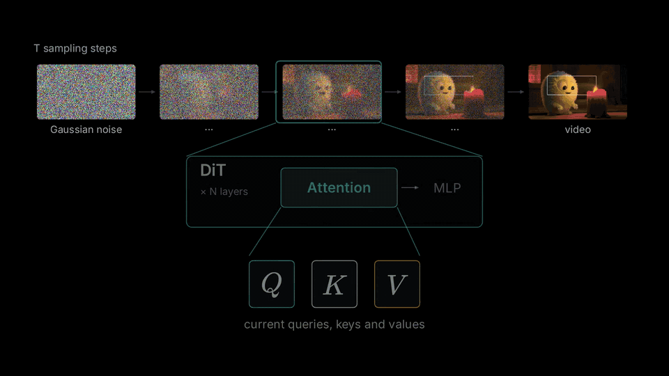
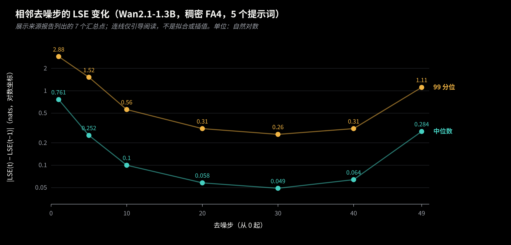
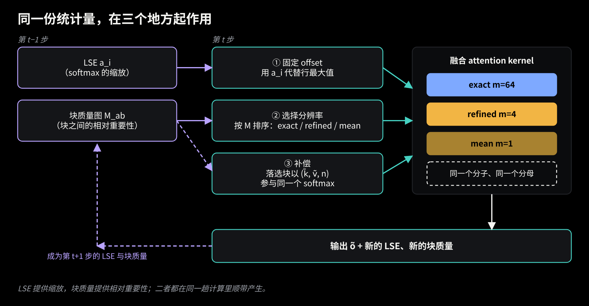
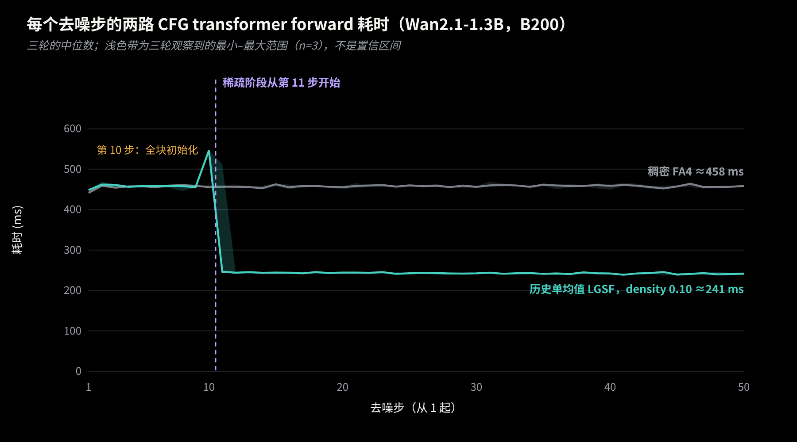
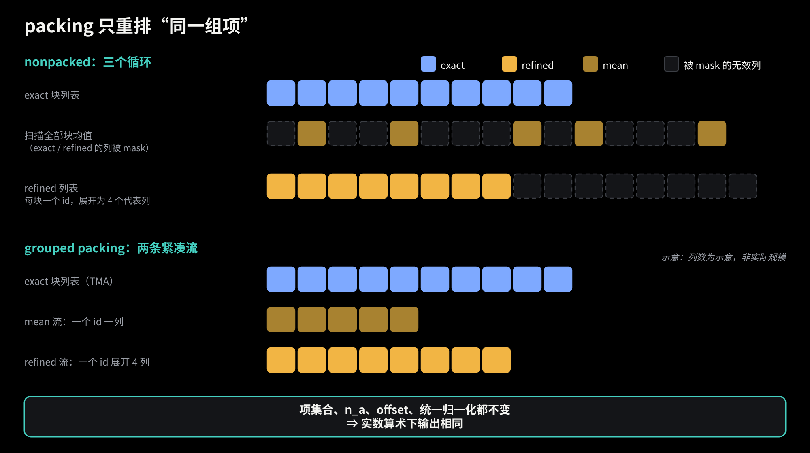
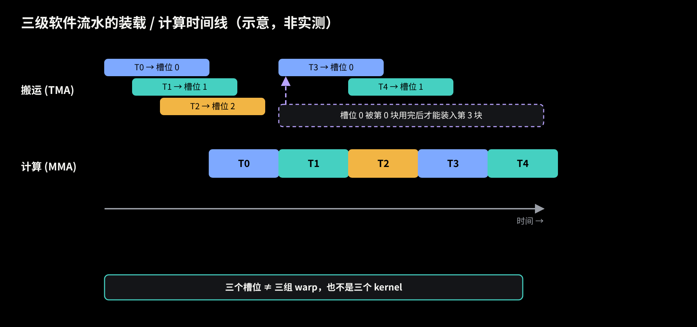
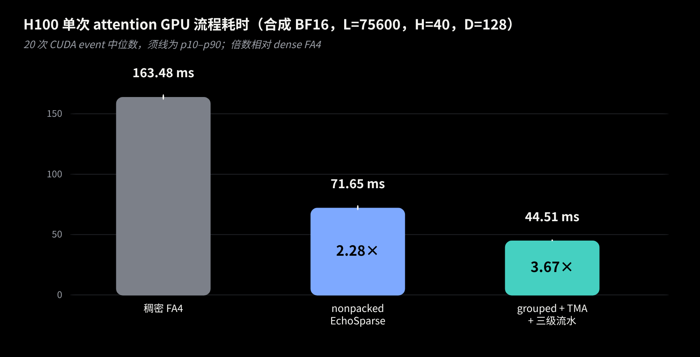
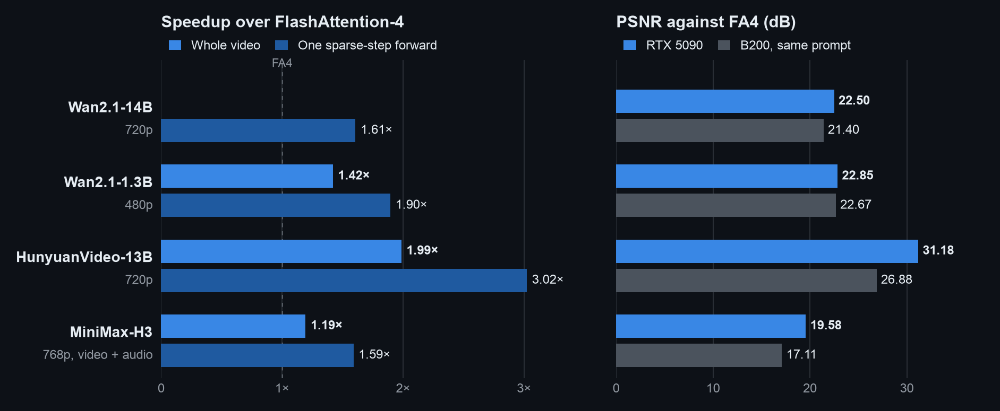

# EchoSparse：让上一步的统计量为下一步指路，再把稀疏 attention 排得更紧

作者 **EchoSparse Team**

视频扩散模型的 self-attention 序列长得吓人。Wan2.1-14B 生成 720p、81 帧的视频，单层要处理约 7.5 万个 token，一次前向过几十层，一个视频要去噪 50 步。很多 KV 块对某个 query 几乎没有贡献，跳过它们看起来很划算。可是一动手就卡在三件事上：不先把所有块扫一遍，怎么知道该跳谁？跳掉的块到底丢了什么，补得回来吗？结构选好之后，GPU 真的能跑快吗？

EchoSparse 用同一个设计回答这三件事：**去噪相邻两步里，每个 attention 行的统计量变化很小，所以上一步留下的 LSE（log-sum-exp）和各块的质量（block mass）可以在本步一起用。LSE 提供 softmax 的缩放，块质量提供“哪些块相对重要”的排序。** 这篇文章按推导的顺序走一遍数学，再看它怎样落到数据布局和 GPU 流水线上，最后给出 H100 实验分支上的一组测量。

代码在这里：**[W2GenAI-Lab/EchoSparse-Attn](https://github.com/W2GenAI-Lab/EchoSparse-Attn)**。下面是仓库里的原动画，文章的顺序和它一致；网页版里还嵌有可重放的[原始 Canvas 动画](assets/echosparse-canvas-animation.html)。

先交代范围。主线 README 目前支持 B200（SM100）和 RTX 5090（SM120）；H100（SM90）和 RTX 4090 的正式适配还在 TODO 里。文中 packed 代表向量、TMA 与三级流水的内容来自 H100 **实验分支**，没有合入主线，我会一路标明。

## 1. 一行 attention 就是一个加权平均

固定一个 query $q\in\mathbb R^d$ 和一组 key/value $\{(k_j,v_j)\}_{j=1}^{N}$，记 $s_j=q^\top k_j/\sqrt d$。这一行的输出是

$$
o=\frac{\sum_j e^{s_j}v_j}{\sum_j e^{s_j}} .
$$

它是 $v_j$ 的加权平均，权重 $e^{s_j}$ 归一化后就是概率。所有 attention 实现都依赖一个小事实：对任何与 $j$ 无关的常数 $c$，

$$
o=\frac{\sum_j e^{s_j-c}v_j}{\sum_j e^{s_j-c}} ,
$$

因为分子分母的 $e^{-c}$ 约掉了。FlashAttention 取 $c$ 为边扫边更新的行最大值，每次最大值变大，已累加的结果就要整体缩放一次，另外还要一次逐行 max 归约。

## 2. 上一步的 LSE 当作固定偏移

记 $a=\log\sum_j e^{s_j}$ 为该行的 LSE。取 $c=a$，$e^{s_j-a}$ 恰好就是 attention 概率。算完之前我们当然不知道本步的 $a$……但等一下，相邻两步的输入差不多，$a$ 会差多少？

*图 1　Wan2.1-1.3B、稠密 FA4、5 个提示词，同层、同 CFG 分支、同一行的 $|\mathrm{LSE}(t)-\mathrm{LSE}(t-1)|$，自然对数单位。图中展示来源报告列出的 7 个汇总点；连线只是引导视线，不是拟合或插值。数据：[docs/REPORT.md §3](https://github.com/Owen718/lse-sparse/blob/05e2dab310bf7c710d8b5276aa588e433823db15/docs/REPORT.md#3-相邻去噪步的-lse-变化13b5-个提示词)（B200 历史开发实验，仓库 Owen718/lse-sparse，commit 05e2dab）。*

图里有两件事要老实看。中间阶段，中位数只有 0.05 到 0.1 nats，很安静；可是开头（第 1 步中位数 0.76）和最后几步（第 49 步 0.28）明显更大，p99 更是到了 2.88 和 1.11。所以“LSE 几乎不变”并不是对每一步都成立。报告里还记着个别（层, 头）的极端行，|δ| 上百，原因没查明。

那它还能当偏移用吗？能，原因在于：**偏移是恒等变换，正确性不依赖前后 LSE 接近**。对任何给定的项集合，减去任意固定的 $c$，输出都不变。所以取上一步同层、同 CFG 分支、同一行的 LSE 作为本步固定偏移 $a_i$，本身不引入误差。接近与否影响的是别的东西：缩放后的行和靠近 1，不容易上溢下溢，kernel 才能省掉 max 归约与 rescale。仓库的实测是，同样的块列表下 kernel 时间约少 47%。行和偏得太远的 tile（README 给的数字约 0.5%）会被标记出来：对它选中的 exact 块用 online softmax 重跑，再叠加跳过块的均值补偿。注意，这不是重算整个 dense attention，也不会自动保留四代表那种压缩形式。实现里用 $\log_2$/$\exp_2$，数学上没有区别。

这个恒等式只管“固定一组项时的 softmax”。后面的稀疏选择和代表压缩是另一回事，那是近似。

## 3. 每个块用什么分辨率

把序列按 64 个 token 分成 KV 块，query 按 128 行分成 tile。对 query tile $a$ 和 KV 块 $b$，块可以用三种分辨率之一参与计算，动画里把用到的行数记作 $m_b$：

- $m_b=64$，exact：保留块里全部原始 token；
- $m_b=4$，refined：用 4 个聚类代表向量代替整块；
- $m_b=1$，mean：用块的平均 K 和平均 V 代替整块。

谁来决定？一个自然的量是

$$
M_{ab}=\sum_{i\in a}\sum_{j\in b}e^{\,s_{ij}-a_i},
$$

这里 $a_i$ 是上一步的 LSE。它是**用历史 LSE 缩放过的、未归一化的块质量**：当先验和真实 LSE 接近时，它接近“tile $a$ 的各行放在块 $b$ 上的概率”，但并不自动等于当前步精确的归一化概率。代码在选块之前会再做缩放和校准（按 tile 汇总 $\exp(a_i-\mathrm{LSE}^{\text{new}}_i)$ 来重新缩放质量，log2 实现里是 $2^{a_i-\mathrm{LSE}^{\text{new}}_i}$，LSE 是对数量，不能直接相除；跳过块的估计再用已精算块校准），所以别把 $M_{ab}$ 当成精确概率。

设共有 $B$ 个 KV 块、密度 $\rho$：质量最大的 $k=\mathrm{round}(\rho B)$ 个块（外加局部邻居）用 exact；接下来按预算 $R$ 的一批块用 4 个代表，README 的说法是落选块里概率最高的约三分之一；其余用 1 个均值。重点是，**没有任何块被丢掉**。落选块只是降低了分辨率，仍然进入下面统一的 softmax。

## 4. 统一的 softmax：一切都是 $(\tilde k_a,\tilde v_a,n_a)$

三种分辨率可以写成同一形状的项。exact 项就是原始 token，$n_a=1$；mean 项是块内平均 K、V，$n_a$ 是块里的有效 token 数（尾块可能不足 64）；refined 项是一个 cluster 的平均 K、V，$n_a$ 是该 cluster 真实的 token 数。输出写成

$$
\tilde o=\frac{\sum_a n_a\,e^{\,q^\top\tilde k_a/\sqrt d}\,\tilde v_a}{\sum_a n_a\,e^{\,q^\top\tilde k_a/\sqrt d}} .
$$

有两个地方特别容易写错。第一，$n_a$ 必须同时出现在分子和分母里：一个代表替 $n_a$ 个 token 说话，就要在分母里占 $n_a$ 份，分子里也乘 $n_a$ 份。把 $n_a e^{x}$ 写成 $e^{x+\ln n_a}$，它就是 logit 上的一个 $\ln n_a$ 修正，实现里加的是 $\log_2 n_a$。空 cluster 的 $\ln n_a=-\infty$，权重自然为零，padding 也一样。第二，exact 项和压缩项共用同一个分子、同一个分母。不能各算一个 softmax 再相加——那样每个部分都被归一化成 1，相对质量全丢了。

用个小例子看看。一个块只有 4 个 token，logits 是 $s=(0,0,2,2)$，$v=(1,1,0,0)$。精确值：分子 $2$，分母 $2+2e^2\approx16.78$，输出约 $0.119$。如果整块用一个 mean：平均 logit 是 $1$，$n=4$，分母 $4e\approx10.87$，平均 $v$ 是 $0.5$，输出 $0.5$。嗯，差得不是一点半点。但把前两个、后两个各聚成一类：logits 分别为 $0$ 和 $2$，$n=2$，结果和精确值完全一致。

近似就出在这里。对一般互不相同的 $k_j$，$\sum_j e^{s_j}\neq n\,e^{\bar s}$（Jensen），平均 $V$ 也不是按真实权重加权的 $V$。所以相对原始 dense attention，代表压缩是**近似**，不是恒等变换。反过来，什么时候能严格恢复？对固定的 query，只要一个 cluster 里所有 key 的 logit 相同，count 加权的代表就精确还原这个 cluster 的贡献，key 完全相同是它的一个充分条件，但不是唯一情形。聚类要做的事，就是让同一类里的 key 在 query 眼中尽量没有差别。

## 5. 在 query 度量下聚类

那“没有差别”怎么量？第一反应是直接对 K 做欧氏 k-means……可是 attention 只通过 $q^\top k$ 看 key，K 空间里远的两个点，query 未必分得出来。

设 $\delta=k-k'$ 是列向量（把 $1/\sqrt d$ 并入 $q$）。两个 key 在 query $q_i$ 面前的 logit 差是 $q_i^\top\delta$，对所有 query 取平均的平方误差是

$$
\frac1L\sum_i\bigl(q_i^\top\delta\bigr)^2=\delta^\top G\,\delta,\qquad G=\mathbb E[qq^\top]=MM^\top ,
$$

其中 $M$ 是 $G$ 的 Cholesky 因子，于是这等于 $\|M^\top\delta\|^2$。若把 key 按行放进矩阵 $K$，变换后的坐标就是 $X=KM$，在 $X$ 里做普通欧氏聚类，最小化的就是各 cluster 内 query 看到的平均 logit 离散度。

细节要补一句：实现里不直接分解 $G$，而是 $G_\epsilon=G+\epsilon I$（$\epsilon$ 取平均对角的 $10^{-3}$ 倍，保证 Cholesky 稳定）。于是变换后的平方距离是

$$
\|M_\epsilon^\top\delta\|^2=\delta^\top G\,\delta+\epsilon\,\|\delta\|^2 ,
$$

也就是原来的平均平方 logit 差**再加**一项很小的欧氏距离。无正则的那个等式是严格的恒等式，带正则的是实际实现，只是在 query 度量上轻轻掺了一点欧氏距离。

每个 64-token 块分成 4 类：用 64 个 probe query 为每个 token 提供权重，做加权 Lloyd 迭代（从四个连续的 16-token 组开始，默认最多 6 次）。权重只影响**谁分到哪一类**；写回的代表 K、V 是 cluster 内的普通均值，$n_a$ 是真实 token 数，这样第 4 节的统一公式才成立。

## 6. 时间反馈：边算边统计

第 3 节需要质量图，如果每步都单独拿全部块去精算打分，省下的又吃回去了。EchoSparse 的办法是让本步已经在算的 exact 块顺便产出质量：固定偏移让 $e^{s_{ij}-a_i}$ 接近概率量级，kernel 在计算选中块时按 64-token 块累加，就是这些块的 $M_{ab}$。

被跳过的块没有精确的 $s_{ij}$，要估一个。EchoSparse 不额外做一遍全量精确的 QK 打分，只运行一个轻量的 `estimate_skipped` 过程：每个 query tile 只抽样若干行，用块均值估计落选块的质量，再用已精算块做校准（校准系数夹在 $[1,64]$ 内），同时得到下一步用的缩放。

*图 2　同一份统计量在三处起作用：LSE 做固定偏移，块质量排序决定每块的分辨率，落选块以 $(\tilde k,\tilde v,n)$ 参与同一个 softmax；融合 kernel 的输出又产生下一步的 LSE 和块质量。*

这个回路需要起点。每个（CFG 分支，层）各自保存自己的状态，CFG 的后续分支可以复用分支 0 的块选择。默认前 **9 步**直接用 FA4 稠密计算，**第 10 步**让所有块都经过固定偏移的 EchoSparse kernel，得到精确输出并建立第一张质量图，之后才进入稀疏步。

*图 3　历史开发实验（Wan2.1-1.3B，B200，480×832、81 帧、50 步、CFG 6），纵轴是两路 CFG transformer forward 的耗时之和，不是 attention 单独耗时，也不是整段视频。三轮的中位数，浅色带是三轮的最小到最大（n=3），不是置信区间。稀疏组是旧的单均值 LGSF（density 0.10，refine=0，每个分支独立选块），不是当前的四代表或 packed 配置。第 10 步是全块初始化，稀疏阶段从第 11 步开始；第 11 步三轮里有一轮出现了 513 ms，所以那里的色带特别宽。数据：[outputs/results/curve13.json](https://github.com/Owen718/lse-sparse/blob/05e2dab310bf7c710d8b5276aa588e433823db15/outputs/results/curve13.json)。*

## 7. 先算一笔账：10% 的密度剩下多少列

谈布局之前，先数一数一个 query tile 实际要处理多少列。实验形状 $L=75600$ 有 $B=1182$ 个 64-token 块（padding 后容量 75648）。密度 0.10 时 exact 块约 118 个，约 $118\times64\approx7.6$ 千列；其余约 1064 个块里约三分之一用 refined，约 355 块、每块 4 列，合计约 1420 列；剩下约 709 块各 1 列。压缩列合计 $1420+709=2129$，与实验记录里的平均值 2129 吻合。

于是每个 tile 面对约 $9.7$ 千列，不到 dense 的 13%，其中压缩列只占五分之一左右。它们很少，但零碎：mean 块只有 1 列，refined 块只有 4 列，既不连续，也离 tensor core 喜欢一口吃下的 64 列很远。列数掉到 13% 以下，下面第 10 节的实测倍数却远没有这个比例，布局确实值得单独花力气。

## 8. packing：同一个计算，更紧凑的排布

算法到此完整，剩下是 GPU 能否高效地跑它。先说清楚 nonpacked（已发布版）实际怎么走，它并不是把 exact、mean、refined 放进同一张混合列表。源码里是三个循环：一个循环遍历 exact 块列表；一个循环以 128 列为单位扫描**全部**块的均值，其中 exact 和 refined 块对应的列被 mask 掉；一个循环遍历 refined 列表，每个块 4 个代表、每块一个 id。于是 mean 循环里有大量被 mask 的无效列，refined 列表也要补到固定宽度。在这次测试的计划里，每个 tile 按基线布局要走 $1280$ 个均值列加 $1536$ 个代表列，共 2816 列，而真正有用的平均只有 2129 列，利用率约 76%。

*图 4　示意图，列数不代表真实规模。左右两边是同一组项：5 个 mean、8 个 refined 代表、10 个 exact 块。nonpacked 用三个循环，mean 循环里大量列被 mask；grouped packing 把它们整理成两条紧凑的流。*

packing 要做的就是重新组织这些列。把参与计算的项记成集合 $\mathcal A$，权重 $w_a=n_a e^{s_a-c}$，输出 $\sum_{a\in\mathcal A}w_a\tilde v_a/\sum_{a\in\mathcal A}w_a$。对 $\mathcal A$ 任意重排、重新分组，或者去掉权重为零的 padding 项（$n_a=0$），分子分母作为实数和都不变：加法满足交换律和结合律，删掉的项本来就贡献零。因此，**在相同的稀疏 plan、代表 K/V、multiplicity 和统一 normalization 下，packing 是一次等价重组，不引入任何额外的算法近似，实数算术下输出理论上相同。** EchoSparse 相对 dense 的近似来自第 4 节的代表压缩，packing 既没有增加也没有减少它。浮点求和顺序变了，舍入会有细微差别，这属于实现细节。

实验分支的 grouped packing 把 descriptor 分成两条紧凑的流：mean 流一个块 id 对应一列；refined 流一个块 id 对应 4 列，在芯片上按 $4\cdot\text{block}+\text{sub}$ 展开。这里的 $4n_g\to n_g$ 比较的是 grouped 与更早的“逐列 packed 流”：后者给每个 refined 代表列各存一个索引，所以一个 refined 块占 4 个 id，grouped 只存一个块 id；nonpacked 的 refined 列表本来就是每块一个 id，不在这个比较里。把两类来源分到两个循环里，混合 tile 里也不必对两个张量都做 masked load。要强调的是，被打包的是 **descriptor 和索引**，并没有把所有代表 K/V 复制成一个连续的大张量。

## 9. GPU 上的搬运与计算：tile、TMA 与三级流水

主循环可以抽象地想成数据在三层存储里流动：HBM、shared memory、寄存器。一个 128 行的 Q tile 在进入 KV 循环**之前**就装好了，之后在整个循环里复用，并不是每轮重新从 HBM 读；每一轮要搬的是 KV 块（或一组代表列）的 K、V，tensor core 算出 $S=QK^\top$，再用 $S$ 和 $V$ 更新累加器。如果搬运和计算一前一后串行，tensor core 就在干等。

解法是流水线：消费当前 tile 的同时，后续 tile 的搬运已经发出。概念上可以说“生产者负责取，消费者负责算”，它们之间用环形缓冲区加依赖和等待来协调。H100 的 TMA（Tensor Memory Accelerator）可以用一个 descriptor 描述张量形状，由专门硬件异步把整块搬进 shared memory。exact 块恰好适合：K、V 的布局是 `[L,H,D]`，一个 64-token 块是其中一块连续的步长 tile，用 block shape `[64,1,D]` 的 descriptor、在行偏移 $64\cdot\text{block}$ 处一次取走。

这和 packing 是衔接的。masked 的全局 load 确实可以少搬一些数据，可是 MMA 以固定 tile 形状发射，一个只有少量有效列的 tile 照样要付出差不多的发射与计算开销，无效列越多，浪费越多。descriptor 列更少、masked load 更少，每一轮的有用比例才高，流水线也才有值得重叠的内容。两项优化可以组合使用，组合后的收益以实测为准，这里不给出任何算术定律。

*图 5　三级软件流水的装载/计算时间线，纯示意，非实测。当第 0 块被消费完、槽位释放之后，第 3 块才能装入同一个槽位；消费者等“数据到了”，装载者等“槽位空了”，这些就是文中说的依赖。*

实验分支现在实现的就是这个组合：**exact 块经 TMA 加载，三级软件流水让搬运与 dot 重叠**，而 grouped 的代表列仍然是指针 gather，没有走 TMA。流水由 Triton 的软件流水调度生成：三个 stage 是环形缓冲区的三个槽位，不是三组分工不同的 warp，更不是三个 kernel。实验里 TMA 单独打开几乎没有收益，只有和多级流水组合才快。顺带一提，主线 SM120 的 kernel 按 32-key 的一半来走一个 64-token 块，而 H100 实验候选用的是 64 宽路径，二者别混为一谈。

真正独立的 producer/consumer 架构（专门的 warp 只搬运，其余 warp 只做 MMA）还**没有实现**。在 Triton 3.6 的 SM90 路径上，我们试了 warp specialization 开关，寄存器、spill、shared memory 与时间都和普通软件流水一致，没有效果；手写的 WMMA 加 cp.async 原型反而更慢。要触到它，需要手写 wgmma 或 CuTe 内核，那是后续工作。

## 10. H100 与 RTX 5090 的实测

### H100 单次 attention 测试

| 方案 | 耗时 | 相对 dense FA4 | 相对 nonpacked |
|---|---:|---:|---:|
| 稠密 FlashAttention-4 | 163.48 ms | 1.00× | — |
| nonpacked EchoSparse（已发布版） | 71.65 ms | 2.28× | 1.00× |
| grouped descriptor + TMA + 三级流水 | 44.51 ms | 3.67× | 1.61× |

测量口径：合成 BF16 的 Q/K/V，形状 `[B,L,H,D]=[1,75600,40,128]`，非因果，稀疏密度 0.10，稀疏计划冻结并由各方案共享，20 次 CUDA event 计时的中位数；对照是 FlashAttention-4（入口 `flash_attn.cute.interface.flash_attn_func`）。稀疏方案的“complete”指 GPU 上的整个稀疏流程，包含代表向量构造和 packing，不含 host 端 descriptor 构造、scratch 分配与编译。这是单次 attention，不是整层 Transformer，更不是端到端视频生成；dense 与稀疏计算的项不同（稀疏平均约 118 个 exact 块加 2129 个压缩列），所以这张表说的是同一份稀疏计划在不同实现下的开销，不代表视频生成会有同样倍数的加速。原始记录见 [evidence/h100_attention_benchmark.json](evidence/h100_attention_benchmark.json)（实验分支结果的脱敏副本）。

1.61× 来自 packing 与流水化这一系统优化，3.67× 里还包含稀疏本身相对 dense 的收益。仅供参考：Wan2.1-14B 在 packing 路径上完整生成一次，从 818.60 s 降到 764.57 s（1.07×），这个比较只相对 nonpacked，每个方案各跑一次，也没有 dense 的完整基线。

### 最新 RTX 5090 完整生成结果

RTX 5090 的已发布结果从另一个角度看系统：整段视频生成，attention 之外的耗时也算进去。最新图补上了 Wan2.1-14B 的**整视频 1.39× 加速**，同一模型的单次稀疏步前向则为 1.61×。

*最新发布的 RTX 5090 结果。每个模型取 B200 评测的第 0 个提示词及相同 seed，EchoSparse 与稠密 FA4 各在单张 GPU 上跑一次 50 步生成。Wan2.1-14B、HunyuanVideo 和 MiniMax-H3 使用按组 CPU 权重 offload，Wan2.1-1.3B 权重驻留 GPU。左侧分别是整段视频和单次稀疏步前向的加速比，右侧是相对 FA4 的 PSNR，并列同一提示词的 B200 数值。这组数据与上面的 H100 合成单 attention 测试口径不同。*

## 11. 适用范围与后续

B200 与 RTX 5090 的结果（含端到端生成）在主线 README 里。H100 路径目前只在实验分支，需显式打开 grouped 代表向量、TMA 和流水级数，尚待集成进主线并补齐多模型 benchmark。最新主线还没有正式的 RTX 4090（SM89）后端，需要单独适配与验收；H100 的 TMA 路径也不能直接搬到 Ada 上。动画里的历史 RTX 4090 数据属于另一批实验，和本文的 H100 测试不是同一个口径。独立的 producer/consumer 调度同样还在路上。

回头看，同一个想法贯穿始终：上一步的统计量既让 softmax 免去 max 与 rescale，也给选块提供排序，还让压缩有了与概率对齐的标尺；统一 softmax 把 exact、refined、mean 放进同一个分子分母，于是 packing 只需要关心“同一组项怎么排”。数学上的等价，是 infra 敢大胆重排数据和流水线的底气。
